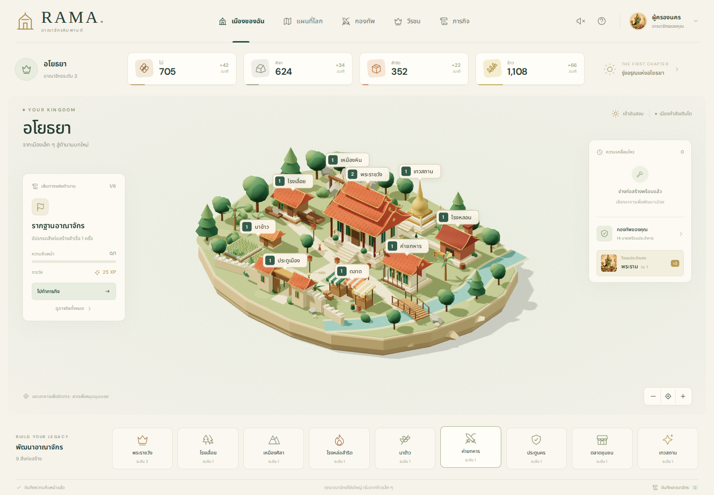

# RAMA — อาณาจักรหิมพานต์

เกมวางแผนสร้างอาณาจักรธีมวรรณคดีไทยสำหรับเว็บ เล่นได้ทั้งคอมพิวเตอร์และมือถือ: พัฒนาเมืองอโยธยา ฝึกกองทัพ พัฒนาพระราม และออกเดินทางผ่านหิมพานต์ไปสู่นครลงกา

เวอร์ชันนี้เป็น **เกมผู้เล่นคนเดียวที่เล่นจบแคมเปญได้** ใช้ Three.js แสดงเมืองสามมิติ มีระบบเศรษฐกิจและจับเวลาจริง พร้อมบันทึกความคืบหน้าในเบราว์เซอร์ ไม่มีบัญชีผู้ใช้หรือเซิร์ฟเวอร์เกม



ภาพจากเกมที่ทำงานจริงบน Chromium ขนาด 1440 × 1000 พิกเซล

## เริ่มพัฒนา

ใช้ Node.js **22.12 ขึ้นไป**; workflow ใช้ Node.js 24

```bash
git clone https://github.com/codelv8/rama.git
cd rama
npm ci
npm run dev
```

เปิด [http://localhost:5173](http://localhost:5173) หากพอร์ตถูกใช้งาน Vite จะแสดงพอร์ตที่เลือกใน terminal

| คำสั่ง | หน้าที่ |
| --- | --- |
| `npm run dev` | เปิด development server |
| `npm test` | ทดสอบกติกาเกมด้วย Node test runner |
| `npm run build` | สร้างเว็บพร้อมใช้งานใน `dist/` |
| `npm run preview` | ทดลอง production build ที่ [http://localhost:4173](http://localhost:4173) |
| `npm run check` | รันชุดทดสอบและ build ต่อเนื่อง |

ไม่ต้องตั้ง `.env`, API key หรือฐานข้อมูลสำหรับเกมเวอร์ชันนี้

## วิธีเล่น

1. เปิด **เมือง** แล้วเลือกสิ่งก่อสร้างหรือป้ายชื่อ เริ่มอัปเกรดโรงเลื่อยเพื่อทำภารกิจแรก
2. เมื่อก่อสร้างสำเร็จ เปิด **ภารกิจ** เพื่อรับทรัพยากรและประสบการณ์
3. เปิด **กองทัพ** แล้วฝึกพลพิทักษ์หรือพลธนู ค่ายทหารระดับ 2 ปลดล็อกวานรศึก
4. ใช้แต้มในหน้า **วีรชน** เพื่อเพิ่มโจมตี ป้องกัน หรือโชคลาภให้พระราม
5. เปิด **แผนที่โลก** เลือกป่าหิมพานต์ ตรวจพลังรบและการสูญเสียที่คาดการณ์ แล้วส่งทัพ
6. พัฒนาพระราชวังถึงระดับ 3 และเสริมกำลังเพื่อเปิดเส้นทางครบ 6 พื้นที่ จนพิชิตนครลงกา

ผลผลิตเข้าคลังอัตโนมัติ การก่อสร้าง การฝึก และการเดินทัพทำพร้อมกันได้ประเภทละหนึ่งรายการ รางวัลภารกิจต้องกดรับตามลำดับ เมื่อจบแคมเปญแล้วยังพัฒนาเมืองและกลับไปสำรวจพื้นที่เดิมได้

### การควบคุม

| การกระทำ | คอมพิวเตอร์ | มือถือ |
| --- | --- | --- |
| เลือกสิ่งก่อสร้าง/จุดหมาย | คลิกโมเดลหรือป้าย | แตะโมเดลหรือป้าย |
| เปลี่ยนมุมเมือง | ลากในฉากเมือง | ลากนิ้วในฉากเมือง |
| เลื่อนแผนที่โลก | ลากแผนที่ | ลากนิ้วบนแผนที่ |
| ย่อ–ขยาย | ล้อเมาส์หรือปุ่มซูม | จีบสองนิ้วหรือปุ่มซูม |
| คืนมุมกล้อง | ปุ่มคืนมุมมอง | ปุ่มคืนมุมมอง |
| เลือกจุดหมายด้วยคีย์บอร์ด | `Tab` แล้ว `Enter`/`Space` | — |

แผนที่โลกยังรองรับ `+`, `-`, `Home` และปุ่มลูกศรเมื่อโฟกัสอยู่ที่แผนที่ เมืองมีปุ่มสิ่งก่อสร้างสำรองหากอุปกรณ์เปิด WebGL ไม่ได้ เสียงประกอบเป็นเสียงสั้นที่สังเคราะห์ในเบราว์เซอร์และเริ่มหลังผู้เล่นเปิดเสียง

## สิ่งที่เล่นได้

- เมืองสามมิติพร้อมสิ่งก่อสร้าง 9 แห่ง เลือกดูและอัปเกรดได้
- ทรัพยากร 4 ชนิด: ไม้ ศิลา สำริด และข้าว พร้อมอัตราผลผลิตและความจุคลัง
- กองทัพ 3 หน่วย: พลพิทักษ์ พลธนู และวานรศึก; รวมทหารที่กำลังออกศึกได้ไม่เกิน 250 นาย
- พระรามพร้อมประสบการณ์ ระดับ และแต้มความสามารถ; ภาพหนุมานและทศกัณฐ์เป็นตัวละครประกอบของตำนาน
- แผนที่โลก 6 พื้นที่ ผลรบคำนวณจากพลังทัพ การสูญเสีย เสบียง และรางวัล
- ภารกิจต่อเนื่อง 6 บท พร้อมรายงานก่อสร้าง การฝึก และการศึก
- บันทึกอัตโนมัติในเบราว์เซอร์ และคำนวณความคืบหน้าเมื่อกลับมาเล่น

### การบันทึกและเวลาที่ไม่ได้เปิดเกม

เซฟอยู่ใน `localStorage` ของเบราว์เซอร์และโดเมนที่เล่น เมื่อกลับมาเปิดเกม ระบบคำนวณผลผลิตย้อนหลังสูงสุด **2 ชั่วโมง** และทำรายการที่ครบเวลาให้เสร็จตามลำดับ ทรัพยากรไม่เกินความจุคลัง

เปิด **ตั้งค่าอาณาจักร** จากปุ่มผู้ครองนครเพื่อเปลี่ยนชื่อเมือง เปิด–ปิดเสียง/บรรยากาศกลางคืน หรือกด **สำรองความคืบหน้าเป็นไฟล์** เพื่อดาวน์โหลด JSON การเริ่มอาณาจักรใหม่มีขั้นตอนยืนยันก่อนแทนที่เซฟเดิม

การล้างข้อมูลเว็บไซต์ เปลี่ยนเบราว์เซอร์ หรือเปลี่ยนโดเมนจะไม่ย้ายเซฟตามไปด้วย ควรเล่นหนึ่งแท็บต่อเซฟ ไม่มีระบบ cloud save หรือซิงก์หลายเครื่อง และยังไม่ได้ติดตั้ง service worker สำหรับเปิดหน้าเว็บใหม่โดยไม่มีอินเทอร์เน็ต

คีย์เซฟสำหรับนักพัฒนา: `rama.kingdom.v1`; คีย์ค่าตั้งค่า: `rama.preferences.v1`

## Build และนำขึ้นโฮสต์

```bash
npm ci
npm test
npm run build
```

นำ **เนื้อหาภายใน `dist/`** ไปวางบน static hosting เช่น Nginx/aaPanel หรือ GitHub Pages ได้เลย `vite.config.js` ใช้ `base: './'` เพื่อรองรับทั้งโดเมนหลักและโฟลเดอร์ย่อย ไม่ต้องรัน Node.js บน production server

### GitHub Actions

Workflow **CI** ทำงานเมื่อ push เข้า `main` หรือเปิด/อัปเดต pull request โดยติดตั้งจาก lockfile รัน `npm test`, `npm run build` และทดสอบการเล่นบน Chromium ที่ขนาด desktop/mobile ด้วย `npm run test:e2e` พร้อมเก็บภาพและรายงานใน artifact `rama-browser-<commit>` แล้วเก็บ `dist/` เป็น artifact ชื่อ `rama-dist-<commit>` นาน 7 วัน ขั้นตอนนี้ไม่เผยแพร่เว็บไซต์

Workflow **Deploy GitHub Pages (manual)** เตรียมไว้สำหรับผู้ดูแลที่ต้องการเผยแพร่:

1. ใน repository ไปที่ **Settings → Pages → Build and deployment → Source → GitHub Actions**
2. ไปที่ **Actions → Deploy GitHub Pages (manual) → Run workflow** และเลือก `main`
3. เมื่อ build และ deploy สำเร็จ เปิด URL ใน deployment ของ environment `github-pages`

Workflow นี้มีเฉพาะ `workflow_dispatch`; การ push โค้ดไม่เริ่มเผยแพร่ Pages โดยอัตโนมัติ และมีเงื่อนไขให้ deploy จาก `main` เท่านั้น ดูรายละเอียด [GitHub Pages custom workflows](https://docs.github.com/en/pages/getting-started-with-github-pages/using-custom-workflows-with-github-pages)

## โครงสร้างที่ใช้พัฒนาต่อ

| ตำแหน่ง | หน้าที่ |
| --- | --- |
| `src/main.js` | หน้าจอ การโต้ตอบ จัดการ state และบันทึกเกม |
| `src/style.css` | Layout สี ตัวอักษร และ responsive UI |
| `src/game/content.js` | ข้อมูลสิ่งก่อสร้าง ทหาร วีรชน ภารกิจ และแคมเปญ |
| `src/game/engine.js` | กติกาเศรษฐกิจ คิวต่อเวลา ผลรบ และตรวจข้อมูลเซฟ |
| `src/render/village.js` | เมือง Three.js และโมเดลที่ประกอบด้วยโค้ด |
| `src/render/world-map.js` | แผนที่โลก SVG การเลือกพื้นที่ และเส้นทางเดินทัพ |
| `src/ui/icons.js` | ไอคอน SVG สำหรับ UI |
| `src/ui/audio.js` | เสียงประกอบผ่าน Web Audio |
| `public/art/hero-atlas.webp` | ภาพวีรชนที่สร้างใหม่สำหรับโครงการ |
| `tests/engine.test.js` | ชุดทดสอบกติกาและความถูกต้องของเซฟ |
| `docs/GAME_DESIGN.md` | แนวเกม ขอบเขต และค่าบาลานซ์ |
| `docs/ASSET_PROVENANCE.md` | แหล่งที่มาและข้อมูลภาพ/ฟอนต์ |

**ขอบเขตปัจจุบัน:** single-player PvE ไม่มี PvP, guild, chat, login, ระบบเติมเงิน, MCP หรือ AI agent ที่เล่นเกมแทนผู้ใช้ หากพัฒนาเป็น multiplayer ต้องย้ายกติกาที่เชื่อถือได้ไปอยู่ฝั่งเซิร์ฟเวอร์; เซฟฝั่งเบราว์เซอร์ไม่ได้ออกแบบเป็นระบบป้องกันการโกง

### กู้คืนไฟล์สำรอง

ไปที่ตั้งค่า → **กู้คืนความคืบหน้าจากไฟล์** เลือกไฟล์ JSON จาก RAMA ตรวจชื่อเมืองและระดับ แล้วกดยืนยัน ระบบตรวจโครงสร้างและจำกัดไฟล์ไม่เกิน 1 MB ก่อนแทนที่เซฟเดิม

### ทดสอบการเล่นผ่านเบราว์เซอร์

```bash
npx playwright install chromium
npm run test:e2e
```

ดูขั้นตอนและหลักฐานที่สร้างโดยชุดทดสอบใน [tests/E2E.md](tests/E2E.md)
